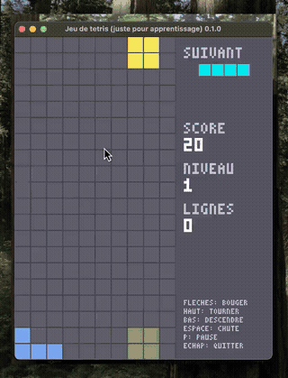

# Tetris en Rust

Un Tetris complet écrit en Rust avec [piston_window](https://crates.io/crates/piston_window), réalisé dans un but d'apprentissage.

## Démo

<p align="center">
  
</p>

Vidéo complète de la partie : [assets/demo.mp4](assets/demo.mp4)

## Fonctionnalités

- Les 7 tétrominos (I, O, T, S, Z, J, L), chacun avec sa couleur
- Tirage par « sac de 7 » : chaque série de 7 pièces contient une pièce de chaque type
- Pièce fantôme indiquant où la pièce va atterrir
- Aperçu de la pièce suivante
- Rotation dans les deux sens, avec décalage automatique contre les murs (*wall kicks*)
- Score, niveaux et chute de plus en plus rapide
- Pause et fin de partie, avec possibilité de rejouer

## Prérequis

- [Rust](https://www.rust-lang.org/tools/install), en version récente (le projet utilise l'édition 2024)

## Lancer le jeu

```sh
git clone https://github.com/Rushclin/rust-tetris.git
cd rust-tetris
cargo run --release
```

## Commandes

| Touche | Action |
|---|---|
| ← / → (ou A / D) | Déplacer la pièce |
| ↑ (ou W / X) | Tourner dans le sens horaire |
| Z | Tourner dans le sens antihoraire |
| ↓ (ou S) | Descendre plus vite |
| Espace | Chute immédiate |
| P | Pause / reprendre |
| R ou Entrée | Rejouer (en pause ou après la fin de partie) |
| Échap | Quitter |

## Règles de score

| Action | Points |
|---|---|
| 1 ligne | 100 × niveau |
| 2 lignes | 300 × niveau |
| 3 lignes | 500 × niveau |
| 4 lignes (Tetris) | 800 × niveau |
| Descente rapide (↓) | 1 par case |
| Chute immédiate (Espace) | 2 par case |

On passe au niveau suivant toutes les 10 lignes, et la chute accélère à chaque niveau.

## Structure du projet

```
src/
├── main.rs      Fenêtre et boucle principale (entrées → logique → affichage)
├── settings.rs  Constantes : dimensions, règles de score, couleurs
├── piece.rs     Tétrominos : forme, couleur, déplacement, rotation
├── bag.rs       Tirage des pièces par « sac de 7 »
├── rng.rs       Générateur pseudo-aléatoire (xorshift), sans dépendance
├── board.rs     Grille : collisions, pièces figées, suppression des lignes
├── game.rs      Logique : gravité, score, niveaux, pause, fin de partie
├── input.rs     Correspondance touches → actions
├── ui.rs        Affichage du plateau, du panneau latéral et des écrans
└── font.rs      Police pixel 3×5 pour afficher du texte sans fichier de police
```

Quelques principes guident l'organisation :

- **`game` ne dépend ni de la fenêtre ni du clavier.** Il reçoit des `Action` et le temps écoulé, ce qui le rend facile à tester.
- **`ui` lit l'état du jeu sans jamais le modifier.**
- **Tous les réglages sont dans `settings.rs`.** Pour changer la taille du plateau, la vitesse ou les couleurs, il suffit de modifier ce fichier.

## Tests

```sh
cargo test
```

Les tests couvrent les rotations des pièces, le tirage par sac, les collisions, la suppression des lignes et la logique de jeu.

## Licence

Ce projet est distribué sous licence MIT. Voir le fichier [LICENSE](LICENSE).
